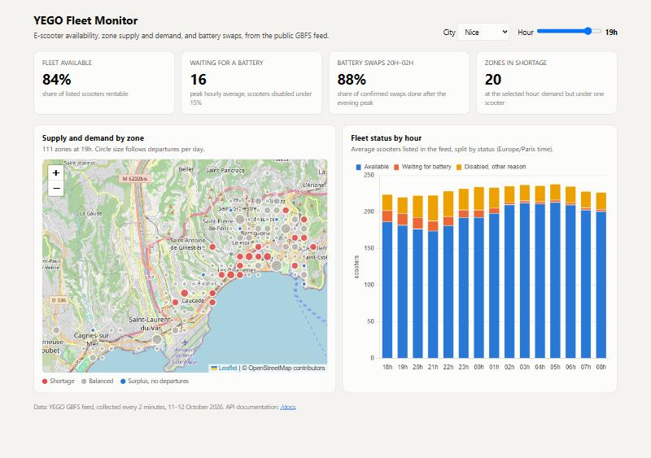

# YEGO Nice — Operations Monitor

[](https://github.com/MariusEtudiant/yego-nice-ops/actions/workflows/ci.yml)

A data product on the YEGO shared e-scooter fleets of Nice and Barcelona, built only from the
operator's public GBFS feed: collection through a REST API, dbt models with data quality tests,
a star schema for a Power BI model, a FastAPI service with a web page, and CI on every push.

**Report:** [`reports/yego_nice_report.tex`](reports/yego_nice_report.tex) (3 pages, LaTeX) ·
one-page note in French: [`reports/note_yego_nice.pdf`](reports/note_yego_nice.pdf)



## Key findings (Nice, 11–12 October 2026)

- YEGO disables every scooter below 15% battery.
- At the 19h demand peak, 16 scooters were waiting for a battery, while 50 of the 57 battery
  swaps happened between 20h and 02h, after the peak.
- About 11% of the fleet is disabled for reasons other than battery.

## Pipeline

```
GBFS REST API ──► collector.py ──► Parquet ──► track_vehicles.py ──► dbt (DuckDB)
  every 2 min                     (raw)        stable scooter IDs     staging → marts → star schema
                                                                            │
                         ┌──────────────────────────────┬──────────────────┤
                         ▼                              ▼                  ▼
              Power BI semantic model         FastAPI + web page     LaTeX / PDF reports
              (TMDL, DAX measures)            (map, KPIs, OpenAPI)
```

1. `src/collector.py` saves the GBFS feed every 2 minutes as Parquet files.
2. `src/track_vehicles.py` rebuilds a stable ID for each scooter, because the feed changes
   `bike_id` at every request.
3. `transform/`: dbt models on DuckDB. Staging, then marts, then a star schema (`dim_city`,
   `dim_zone`, `dim_hour` around three fact tables). Data quality is checked by 31 tests:
   not-null and unique keys, referential integrity between facts and dimensions, battery in
   range, coordinates inside the city, collection gaps, and a business rule (no active scooter
   under 15% battery).
4. `src/export_bi.py` writes the star schema to `data/bi/` (68 KB, versioned).
5. `powerbi/`: the Power BI semantic model as a TMDL script, generated from the Parquet schema:
   relationships, hidden keys, sort orders, geographic categories and 15 DAX measures. See
   [`powerbi/README.md`](powerbi/README.md).
6. `api/` and `web/`: a FastAPI service (`/api/cities`, `/api/cities/{city}/fleet`,
   `/zones?hour=`, `/swaps`, typed responses, OpenAPI docs at `/docs`) and a web page with a zone
   map, KPIs and the fleet status by hour.
7. `.github/workflows/ci.yml`: on every push, rebuilds the dbt models and tests from the
   versioned data in `data/compact/`, exports the star schema and runs the API tests.
8. `.github/workflows/collect.yml`: collects the feed in the cloud. Every hour, 55 minutes of
   snapshots (one every 2 minutes) are merged into one file per city and committed to the
   `data` branch, so no computer has to stay on.

## Run

```bash
pip install -r requirements.txt
git fetch origin data && git archive origin/data data | tar -x   # get the cloud collection
python src/pipeline.py                  # tracking, dbt build, reports, BI export, TMDL
uvicorn api.main:app --reload           # web page on http://127.0.0.1:8000, API docs on /docs
pytest                                  # API tests
```

Without a local collection, dbt runs on the versioned data:

```bash
cd transform && dbt build --profiles-dir . --vars '{source: compact}'
```
